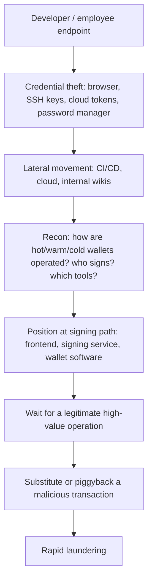

# From Intrusion to Theft

After initial access, public incident reports describe a progression aimed at signing capability.

## Typical chain



Reconnaissance is often the longest phase. Attackers read internal documentation, chat channels and tickets to learn the schedule and shape of treasury operations. Anything that describes "how we move funds" is target material, so treat runbooks for signing ceremonies as sensitive.

## Why "wait for a legitimate operation"

Many organisations require multiple approvals and hardware wallets. Instead of breaking those, attackers manipulate *what is presented* during a real, scheduled operation (e.g. a cold-to-warm transfer). All signers approve, believing they are signing the routine transaction. The Bybit reporting describes exactly this.

In the Bybit case, public statements from Safe{Wallet} and the forensic firms described malicious JavaScript served from Safe{Wallet}'s hosting that targeted Bybit's specific Safe. The transaction signers approved was a `delegatecall` to an attacker contract that changed the Safe's implementation, handing control to the attacker. Hardware wallets showed the data to sign, but the data was a hash or opaque calldata that humans could not meaningfully check. That is the core lesson: **multisig only helps if each signer verifies independently.**

## Detection opportunities along the chain

| Stage | Signal |
|---|---|
| Endpoint | unusual Node/Python processes after cloning repos; browser credential access |
| Cloud | new access keys; S3/CDN object changes outside deployment pipelines |
| CI/CD | workflow modifications; new secrets access |
| Frontend | served JS differs from the release build hash |
| Signing | transaction parameters differ from the ticketed request; delegatecall present |

The signing row is the last line of defence and the cheapest to implement well. Every other row can be evaded by a careful attacker; a signer who recomputes the transaction hash from the ticket on an independent machine cannot be fooled by a tampered frontend.

## Controls that break the chain

- Signing machines isolated from daily-use endpoints.
- Independent transaction verification (recompute hashes from the ticketed intent).
- Integrity monitoring of production frontends against reproducible build hashes.
- Short-lived cloud credentials and alerting on CDN/storage writes.
- A policy, enforced by a Safe Guard or equivalent where possible, that rejects `delegatecall` and owner or module changes outside a separate, slower process.

## Worked example

_Not executed in this book's CI; verify locally. Outputs shown are expected results, not captured runs._

Goal: independently verify a Safe multisig transaction before signing, using only the ticketed intent and an RPC node, not the web UI. Use a test Safe on a testnet or a local fork.

1. Write down the intent from the change ticket: target, value, calldata, operation type, nonce.

```bash
export RPC=http://127.0.0.1:8545            # anvil fork or testnet RPC
SAFE=0x0000000000000000000000000000000000005afe   # placeholder: your Safe
TO=0x00000000000000000000000000000000000000d0     # e.g. your warm wallet
VALUE=$(cast to-wei 10)
DATA=0x
OP=0                                           # 0 = CALL, 1 = DELEGATECALL
NONCE=$(cast call $SAFE "nonce()(uint256)" --rpc-url $RPC)
```

2. Ask the Safe contract itself for the hash it will check signatures against.

```bash
cast call $SAFE \
 "getTransactionHash(address,uint256,bytes,uint8,uint256,uint256,uint256,address,address,uint256)(bytes32)" \
 $TO $VALUE $DATA $OP 0 0 0 0x0000000000000000000000000000000000000000 \
 0x0000000000000000000000000000000000000000 $NONCE --rpc-url $RPC
```

3. Compare that hash with the one your hardware wallet displays when you sign. If they differ, stop. Open-source tools such as `safe-tx-hashes-util` compute the same hashes offline and also show the domain and message hashes some hardware wallets display.

4. Check the risky fields explicitly.

```bash
[ "$OP" = "0" ] || echo "STOP: delegatecall requested"
cast 4byte-decode "$DATA" 2>/dev/null   # empty for a plain ETH transfer
```

Expected result: a 32-byte hash computed from the ticket on a machine that never loaded the signing UI. Each signer repeats this independently. A tampered frontend that changes `TO`, `DATA` or `OP` produces a different hash and is caught.

## Common pitfalls

- Every signer using the same web UI on similar machines, so one compromise fools them all.
- Hardware wallets in blind-signing mode with no process to check what the hash represents.
- Treating `delegatecall` as an advanced feature rather than a red flag in routine treasury transfers.
- Monitoring CI/CD but not direct writes to the storage bucket or CDN that serves the frontend.
- Signing runbooks stored in wikis readable by every employee.
- Assuming the vendor's frontend is safe because the vendor is reputable.

## Exercises

1. Walk your organisation's signing ceremony and mark each point where displayed data comes from a single system.
2. Implement a frontend integrity monitor comparing served bundles to release hashes.
3. Write a detection for S3/CDN object modifications outside your deployment role.
4. Run the worked example on a testnet Safe with a deliberately altered `DATA` field and confirm the hash changes.

## Further reading

- Bybit and Safe{Wallet} post-incident statements and third-party forensic summaries (Feb–Mar 2025)
- Sygnia and Mandiant public updates on the Bybit investigation
- Safe smart account documentation: <https://docs.safe.global>
- safe-tx-hashes-util: <https://github.com/pcaversaccio/safe-tx-hashes-util>
- See **Web3 Supply Chain Security** Chapter 2 in this wiki.
