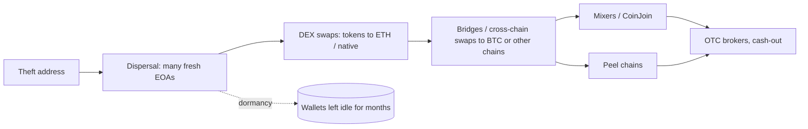

# Laundering Patterns

Public analyses by blockchain analytics firms describe consistent laundering behaviour after DPRK-attributed thefts. Understanding it helps exchanges, bridges and protocols freeze funds faster.

## Observed patterns (as reported)

1. **Rapid dispersal** across many addresses within hours.
2. **Swaps to ETH or BTC**, often via DEXs to avoid centralised KYC.
3. **Cross-chain bridges** to fragment the trail (e.g. to Bitcoin via bridges or swap services).
4. **Mixers:** Tornado Cash (sanctioned by OFAC in 2022, a designation later lifted in 2025 after court rulings), Sinbad (sanctioned 2023), and Bitcoin CoinJoin services have all been reported in use.
5. **Peel chains** on Bitcoin.
6. **OTC brokers** in the final cash-out stage, outside public view.
7. **Dormancy:** funds sit for months, then move.

After the Bybit theft (2025), analytics firms and the FBI reported very fast conversion of stolen ETH and heavy use of cross-chain swap services, including THORChain, to move value to Bitcoin. Whatever the specific route in a given case, the shape is the same: the first hours are when funds are most concentrated and most freezable.



## Where freezing is possible

| Hop | Who can act | Typical lever | Time window |
|---|---|---|---|
| Stablecoins held by attacker | issuer (e.g. Tether, Circle) | address blacklist | minutes to hours, before swap |
| Centralised exchange deposit | exchange | freeze account, hold deposit | until withdrawal |
| Bridge with a validator or operator set | bridge operator | pause, refuse to relay | while message is pending |
| DEX swap | usually nobody | front-end screening only | none on-chain |
| Mixer, CoinJoin | nobody | probabilistic tracing only | none |
| OTC broker | law enforcement | legal process | weeks to months |

The table explains the attacker's sequencing: convert anything freezable (stablecoins) first, avoid custodial hops early, and only touch exchanges or brokers once the trail is fragmented.

## What defenders can do

- **Exchanges:** ingest attacker address lists quickly (SEAL 911 and analytics vendors publish them during incidents), screen deposits, and freeze.
- **Stablecoin issuers:** blacklisting can freeze USDT/USDC in attacker addresses, which is why attackers swap out of stablecoins fast.
- **Bridges and swap services:** rate limits, screening and co-operation with incident responders.
- **Protocols:** consider screening policies for front-ends; recognise the trade-offs.
- **Victims:** publish addresses early through trusted channels; time matters more than completeness.

Screening has costs: false positives on innocent users who received dust from a flagged address, and the limits of front-end screening when contracts can be called directly. Write the policy down before an incident, not during one.

## Tracing exercise template

```
1. Start: exploit tx hash, attacker EOA(s)
2. Expand: all outgoing transfers within 24h (incl. internal txs)
3. Label: DEX routers, bridges, mixers, exchanges
4. Follow: swap outputs and bridge destinations
5. Report: addresses still holding funds; exchange deposit addresses
```

## Worked example

_Not executed in this book's CI; verify locally. Outputs shown are expected results, not captured runs._

Goal: measure the first-24-hour dispersal of a public theft with DuckDB, and list the hops where a freeze was possible. Export native and ERC-20 transfers for the attacker's addresses (explorer API `txlist`, `txlistinternal`, `tokentx`) into `xfers.csv` with columns `ts,tx,from_addr,to_addr,asset,amount`. Prepare `labels.csv` with `addr,label,kind` from public explorer labels (kind = cex, bridge, dex, mixer, issuer).

1. Load and normalise.

```sql
CREATE TABLE x AS SELECT to_timestamp(ts) ts, tx, lower(from_addr) f, lower(to_addr) t, asset, amount
FROM read_csv_auto('xfers.csv');
CREATE TABLE l AS SELECT lower(addr) addr, label, kind FROM read_csv_auto('labels.csv');
CREATE TABLE seed AS SELECT lower(column0) addr FROM read_csv_auto('attacker.csv', header=false);
```

2. Hop-1 dispersal in the first 24 hours.

```sql
WITH t0 AS (SELECT min(ts) t0 FROM x WHERE f IN (SELECT addr FROM seed))
SELECT count(DISTINCT t) AS hop1_recipients, sum(amount) AS moved, asset
FROM x, t0 WHERE f IN (SELECT addr FROM seed) AND ts < t0 + INTERVAL 24 HOUR
GROUP BY asset ORDER BY moved DESC;
```

3. Which labelled hops did funds touch, and when?

```sql
SELECT l.kind, l.label, min(x.ts) first_seen, count(*) n
FROM x JOIN l ON x.t = l.addr GROUP BY 1,2 ORDER BY first_seen;
```

Expected output: a recipient count and amounts per asset, then a time-ordered list of the first exchange, bridge, issuer-controlled or mixer touchpoints. Annotate each row with the freezing lever from the table above and the time between theft and that hop. That gap is your organisation's response budget for the next incident.

4. Write up observations only. Attribution, if any, is cited from the authority that made it.

## Common pitfalls

- Tracing into a DEX router or bridge contract and stopping there, instead of following the output asset or destination chain.
- Waiting for a complete trace before sharing addresses. Partial lists shared early through SEAL 911 or vendors enable freezes.
- Treating every address that received dust from the attacker as complicit.
- Forgetting dormant wallets. Set alerts on them; they move months later.
- Confusing sanctions status of a protocol with legal advice. Ask counsel; designations change, as Tornado Cash's did.

## Exercises

1. Pick a public incident and trace the first 24 hours of fund movement using an explorer and DuckDB.
2. Identify which hops would have allowed a freeze.
3. Write a playbook for an exchange receiving an attacker address list.
4. Set up alerts on three dormant addresses from a public report and record when (if ever) they move.

## Further reading

- Chainalysis, Elliptic and TRM Labs public reports on DPRK laundering
- OFAC sanctions actions (Tornado Cash 2022 designation and 2025 delisting; Sinbad 2023): <https://ofac.treasury.gov>
- SEAL 911: <https://securityalliance.org>
- DuckDB: <https://duckdb.org>
- See **On-Chain Malware Analysis** Chapter 7.
