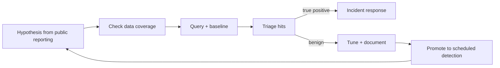

# Detection and Threat Hunting

Hunting for this adversary means looking at endpoints, identities and the signing path, not just on-chain data.

## Hunting hypotheses

| Hypothesis | Data | Query idea |
|---|---|---|
| A developer ran a malicious coding test | EDR process trees | `node`/`python` spawned by package managers making outbound connections to rare domains shortly after `git clone` |
| Browser wallet data is being harvested | EDR file access | non-browser processes reading browser extension storage directories |
| An IT-worker identity is fraudulent | IdP + network | logins from consumer VPNs, remote-access tools (e.g. multiple RMM products), mismatched geolocation vs payroll address |
| Frontend tampering | CDN/storage logs | object writes not from the deploy pipeline role |
| Signing manipulation | wallet/multisig logs | transactions with delegatecall or owner changes outside change tickets |

A good hypothesis names the behaviour, the data source that would show it, and what "normal" looks like. "Node reading wallet extension storage" is only useful if you know which legitimate tools do that in your fleet (some developers run wallet test harnesses). Baseline first, then hunt.

## The hunt loop



Each hunt that finds nothing should still produce something: a coverage note ("we have no file-access telemetry on macOS developer laptops") or a scheduled detection. Coverage gaps found during hunts are often the most valuable output.

## Indicators

Vendors publish IOCs (domains, hashes, npm package names) for these campaigns. They change quickly. Rely on **behavioural** detections and use IOCs as a supplement.

When you do use IOCs, record the source, date and expiry for each. Retro-hunt them against historical DNS and proxy logs (often more useful than blocking them going forward), then retire them.

## Hunting fraudulent insiders

The IT-worker hypothesis needs different data and more care than malware hunts, because it concerns real employees. Agree the scope with HR and legal before you start. Useful signals from public guidance: company laptops showing remote monitoring and management tools that IT did not install, logins consistently through consumer VPN or hosting-provider IP ranges, keyboard-layout or language settings that change between sessions, and payroll or shipping details that do not match the identity checked at hiring. Score these together and route high scores to a confidential review, not to an automatic account suspension.

## Sigma-style example

```yaml
title: Package manager child process reading browser wallet extension data
logsource: { product: windows, category: file_access }
detection:
  selection:
    TargetFilename|contains:
      - '\Local Extension Settings\nkbihfbeogaeaoehlefnkodbefgpgknn'   # MetaMask extension id
    Image|endswith: ['\node.exe', '\python.exe']
  condition: selection
level: high
```

The extension ID above is MetaMask's public Chrome Web Store ID. Extend the list with the wallets your staff use.

Note the data requirement: the `file_access` category needs telemetry that records reads, which Sysmon does not provide by default. Many EDR products do; otherwise use Windows object-access auditing (event 4663) with a SACL on the directories you care about, or the equivalent on macOS and Linux (Endpoint Security framework, auditd).

## Worked example

_Not executed in this book's CI; verify locally. Outputs shown are expected results, not captured runs._

Goal: prove the detection works end to end with a **benign** purple-team simulation, on a test Windows VM you control.

1. Create a canary directory that mimics a wallet extension's storage path in a test user profile. It contains only a dummy file.

```powershell
$p = "$env:LOCALAPPDATA\Google\Chrome\User Data\Default\Local Extension Settings\nkbihfbeogaeaoehlefnkodbefgpgknn"
New-Item -ItemType Directory -Force $p | Out-Null
Set-Content "$p\CANARY.txt" "purple-team canary, no secrets"
```

2. Enable read auditing on that folder (if your EDR does not already log file reads).

```powershell
auditpol /set /subcategory:"File System" /success:enable
$acl = Get-Acl $p
$rule = New-Object System.Security.AccessControl.FileSystemAuditRule("Everyone","ReadData","ContainerInherit,ObjectInherit","None","Success")
$acl.AddAuditRule($rule); Set-Acl $p $acl
```

3. Simulate the behaviour with Node: list and read the canary, nothing else.

```powershell
node -e "const p=process.env.LOCALAPPDATA+'\\Google\\Chrome\\User Data\\Default\\Local Extension Settings\\nkbihfbeogaeaoehlefnkodbefgpgknn'; console.log(require('fs').readdirSync(p))"
```

4. Convert the Sigma rule for your SIEM and run it.

```bash
pip install sigma-cli
sigma plugin install splunk
sigma convert -t splunk -p splunk_windows wallet_read.yml
```

Expected result: one alert naming `node.exe` and the canary path. If nothing fires, you have found a telemetry or mapping gap, which is the point of the exercise. Remove the audit rule and canary afterwards.

## Common pitfalls

- Writing file-access rules for a fleet that does not collect file-read telemetry, and treating silence as safety.
- Hunting only on Windows when much of the targeted engineering population uses macOS.
- Loading large IOC lists with no source or expiry, then never retiring them.
- No baseline: flagging every developer who runs wallet test tooling.
- Hunting identity fraud only at hiring time and not during employment (new RMM tools, new VPN patterns).
- Simulating with real stealer samples instead of benign canaries.

## Exercises

1. Implement two hunting hypotheses in your SIEM and run them over 30 days.
2. Collect current public IOCs for a recent campaign and check your DNS logs.
3. Run a purple-team exercise with a benign "coding test" that simulates the behaviour.
4. Write the macOS equivalent of the Sigma rule and identify which telemetry source supplies it.

## Further reading

- Sigma: <https://github.com/SigmaHQ/sigma>
- sigma-cli: <https://github.com/SigmaHQ/sigma-cli>
- MITRE ATT&CK group pages for Lazarus Group (G0032): <https://attack.mitre.org/groups/G0032/>
- See **Browser Extension Wallet Malware** in this wiki.
